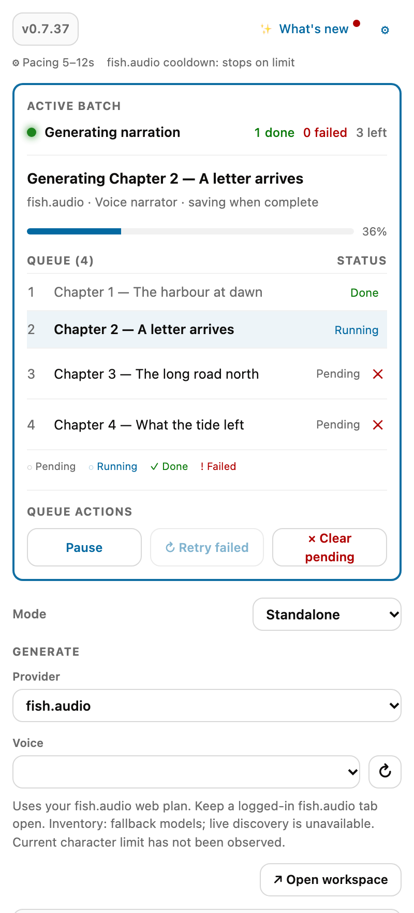
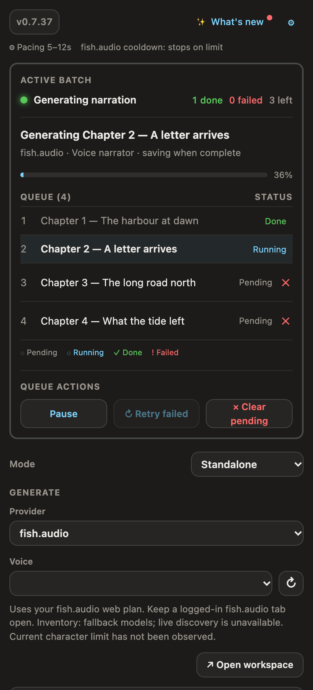

# Story Studio Audio Generator

A Chrome extension for turning scripts into organized audio files.

## What It Does

- Has two modes: **Standalone** (the default) and **Gateway Studio**.
- Standalone: paste one or more scripts, choose the provider and voice, and save the finished audio to Downloads.
- Gateway Studio: claim audio jobs from a connected Gateway worker, using the same provider workspace and generation panel.
- Runs work through a persistent queue with progress, pause, retry, and recovery controls.
- Keeps the exact selected voice and model snapshot with each queued item.

## Workflow

1. Open the side panel and choose a mode.
2. Pick a provider and voice, then load its available choices from a signed-in provider tab.
3. In Standalone, paste scripts (separate several with a line containing `---`) and queue them; finished files are saved to Downloads.
4. In Gateway Studio, enable the worker in Settings. Gateway supplies each script, model, and voice.

## Availability

Audio generation uses supported signed-in provider web sessions; no developer API key is required. The extension discovers the account's available voices, models, controls, and limits.

## Gateway Studio mode

Gateway Studio pairs the extension with Gateway Studio KH as an outbound worker: it opens no port and is never called by the server.

- **Pair** with a worker id and token from Gateway's Browser workers pane. Pairing does not arm
  dispatch; dispatch has to be turned on for that worker.
- **Account identity must be provider-observed and opaque.** The account provider must equal the
  job's provider (`fish` or `elevenlabs_web`); a credit balance can never authorize an audio
  job, and an unreadable balance is reported as unknown, never as zero.
- **An unclaimed quote preview is read-only.** Nothing is enqueued, and no paid request is replayed
  when the outcome is unknown — uncertain work is held for review.
- Readiness is never inferred from a live process, and a missing observation keeps the claim
  refused rather than guessed.
- Browser TTS is outside this extension and stays optional and off.

## Screenshots

The side panel while a batch runs: the active batch with its progress, the queue with each
script's status, and the mode and provider controls underneath.

Also available: [the side panel in its idle state, before anything is
queued](docs/screenshots/panel-idle-light.png), and [the Settings page, where the theme and the
opt-in Gateway worker are configured](docs/screenshots/settings-light.png).

## Install

1. Open `chrome://extensions` and enable Developer mode.
2. Choose **Load unpacked** and select this repository folder.
3. Open the extension from the Chrome toolbar to use the side panel.

## Notes

- Requires a signed-in Fish Audio or ElevenLabs web session.
- The queue is designed to survive closing and reopening the side panel.
